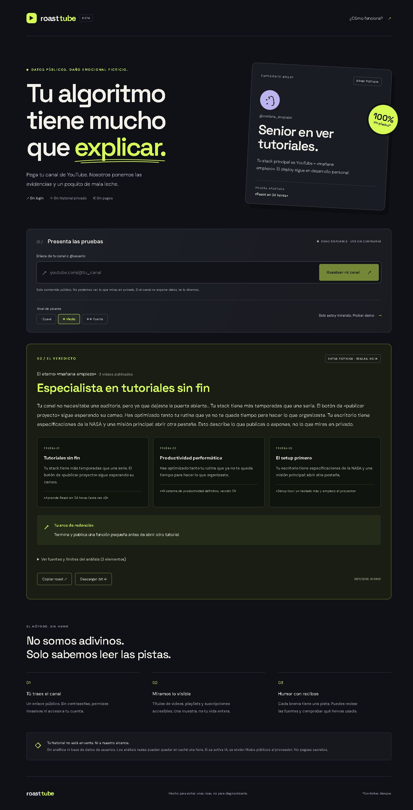

# RoastTube

[](https://github.com/Trefu/youtube-roast/actions/workflows/ci.yml)

**Pega un canal de YouTube → recibe un roast con evidencias públicas.**

Portfolio full stack en español. React + TypeScript + Vite en el frontend; Cloudflare Worker y YouTube Data API en el backend. Sin login, base de datos ni API de pago obligatoria.

## Qué funciona

- Interfaz responsive, estados de carga/error, intensidad, fuentes y límites del análisis.
- Demo ficticia explícita, utilizable sin cuentas ni claves.
- Análisis real de un `@handle`, URL de canal o ID: videos publicados, títulos de playlists y suscripciones accesibles.
- Motor humorístico de reglas: funciona con datos reales **sin contratar IA**.
- Roasts dirigidos al personaje público del creador: promesas de títulos, tono editorial y autopromoción; tres intensidades que cambian los golpes, no solo la apertura. No se inventa vida privada.
- Integración opcional con Workers AI, desactivada por defecto; fallback explícito a reglas si falla.
- Copia y descarga del informe en texto, caché de una hora en Cloudflare y defensas básicas contra abuso.

**No lee historial, likes privados, búsquedas ni “Ver más tarde”.** Tampoco analiza el contenido de cada playlist: el MVP solo recoge su título. Una cuenta sin datos públicos recibe un resultado de información insuficiente, no un perfil inventado.



## Arranque local

Requisitos: Node.js 22.12+ o 24+, npm, Windows/macOS/Linux.

```powershell
git clone https://github.com/Trefu/youtube-roast.git
cd youtube-roast
npm ci
npm run dev
```

Abre `http://127.0.0.1:5173`. Vite sirve la interfaz y envía `/api` al Worker local en `8787`. Sin secretos, pulsa **Probar demo**.

Alternativa para probar exactamente el build servido por el Worker:

```powershell
npm run preview
```

Abre `http://127.0.0.1:8787`. No hace falta iniciar sesión en Cloudflare para la demo local.

## Activar datos reales de YouTube

1. En Google Cloud Console, crea/selecciona un proyecto y habilita **YouTube Data API v3**.
2. Crea una API key. Restringe su uso a **YouTube Data API v3**. No uses restricciones de HTTP referrer para una clave usada desde backend; un Worker no tiene una IP de salida fija para una allowlist sencilla.
3. Copia `.dev.vars.example` a `.dev.vars` y escribe la clave. Nunca la pongas en React, en una variable `VITE_*`, en Git o en el chat.
4. En `wrangler.jsonc`, cambia `vars.ENABLE_LIVE` a `"true"` para desarrollo local (ya está activado en esta versión; sin una clave válida no se habilita el servicio).
5. Reinicia `npm run dev` y prueba un canal con contenido público.

El servidor realiza como máximo **4 consultas a endpoints list** por análisis no cacheado. No se usa `search.list`, no hay paginación ni reintentos automáticos. Verifica cuotas y precios actuales en la consola y documentación de Google; el número de peticiones no equivale necesariamente a unidades de cuota.

El indicador superior debe mostrar **ANÁLISIS EN VIVO ACTIVO**. Esto confirma configuración, no que Google haya validado la clave; la primera consulta real comprueba el acceso.

## Publicar (acción manual, no realizada por el agente)

Necesitas una cuenta de Cloudflare. **No actives un plan de pago para esta demo.** Comprueba que el despliegue y los servicios elegidos están disponibles en el plan gratuito de tu cuenta.

```powershell
npx wrangler login
npx wrangler secret put YOUTUBE_API_KEY --env production
npm run deploy
```

`npm run deploy` ejecuta pruebas y build antes de publicar el entorno `production`. Wrangler devuelve una dirección `*.workers.dev`; no necesitas dominio. El mismo Worker sirve assets y API en un único origen.

**Producción está separada de desarrollo:** por petición del usuario, `env.production` activa YouTube y Workers AI, con `REQUIRE_ABUSE_GUARD=true`. Requiere el secreto de YouTube y el binding `ANALYSIS_BUDGET`; sin protección no se ejecuta el análisis real. Para publicar únicamente demo, cambia `env.production.vars.ENABLE_LIVE` y `ENABLE_AI` a `"false"`.

La protección usa un único Durable Object con almacenamiento SQLite (disponible en Workers Free). Reserva de forma atómica **20 intentos globales al día UTC**, hasta **3 por IP al día** y **uno por minuto**. También cuentan fallos y respuestas cacheadas; no se reembolsa una reserva. El contador persiste entre instancias y despliegues mientras se mantengan el namespace y el nombre del objeto. No impide ataques de denegación de servicio ni que un atacante agote los 20 intentos. No es un límite monetario universal para toda la cuenta.

El secreto opcional `OWNER_IP` permite a direcciones exactas saltarse únicamente los límites personales y la espera; **sus intentos siguen contando dentro de los 20 globales**. Admite una IP o varias separadas por comas, por ejemplo IPv4 e IPv6 del propietario, sin rangos ni comodines. Configurar mediante `npx wrangler secret put OWNER_IP --env production`, nunca en código ni `vars`. No es autenticación: cualquiera que comparta una IP permitida obtiene la excepción; si cambia la IP pública (incluidas IPv6 temporales), hay que actualizarla. Las direcciones permitidas se conservan en el secreto hasta actualizarlo o eliminarlo, no en el contador diario.

Para validar el bundle sin publicar:

```powershell
npm run deploy:dry
```

## IA opcional: no es necesaria

El motor por defecto es determinista y la interfaz lo identifica como **REGLAS, NO IA**. Esta elección evita depender de tokens gratuitos y permite una demo con datos reales sin coste de inferencia.

Para experimentar con Workers AI:

1. Verifica disponibilidad, modelo y límites gratuitos vigentes; no hay garantía de capacidad ilimitada.
2. Para desarrollo, añade al nivel raíz de `wrangler.jsonc` (para producción configura el binding específicamente en `env.production`; los bindings no se heredan entre entornos):

```json
"ai": { "binding": "AI" }
```

3. Cambia `ENABLE_AI` a `"true"` y comprueba `AI_MODEL`.
4. El soporte local de IA puede requerir inferencia remota/autenticación. No asumas que `--local` convierte el modelo en una IA ejecutada en tu PC.

Solo se envían títulos públicos y su tipo de evidencia, no IP, descripción ni nombre del canal. Una suscripción no se trata como autoría de ese contenido. La respuesta debe ser JSON y citar títulos existentes sin repetir evidencia o chiste en varias tarjetas. Si falla, es inválida o tarda más de 15 s, se usa el motor de reglas. El timeout de la aplicación **no garantiza cancelar inferencia remota ni consumo**. La validación estructural no garantiza moderación, calidad humorística ni veracidad semántica: la evaluación amplia sigue pendiente.

## Calidad

```powershell
npm test
npm run build
npm run check
```

Las pruebas automáticas usan respuestas simuladas de Google: **no demuestran acceso real a YouTube**. Sigue la lista manual de `PLAN.md` para la verificación con credenciales.

GitHub Actions ejecuta las pruebas, TypeScript, build y validación del bundle del Worker sin secretos ni despliegue. Dependabot propone actualizaciones mensuales; no se fusionan automáticamente. Lee también [SECURITY.md](SECURITY.md).

## Estructura

```text
src/main.tsx          Interfaz React
src/styles.css       Diseño responsive
src/shared.ts        Contratos frontend/backend
worker/index.ts      Rutas, validación HTTP, caché, IA opcional
worker/youtube.ts    Cliente acotado de YouTube Data API
worker/core.ts       Parseo, motor de reglas y validación IA
tests/               Pruebas unitarias y de contrato
AGENTS.md            Reglas y contexto para otro chat
PLAN.md              Estado, pendientes y guía de evaluación
```

## Coste, privacidad y límites

- No existe promesa de hosting/API gratuito ilimitado. Mantén las cuotas de proveedor; una alerta presupuestaria no es un hard cap.
- `ENABLE_LIVE=false` y `ENABLE_AI=false` son interruptores de emergencia.
- En producción el Durable Object limita globalmente las reservas antes de Google e IA, con fallo cerrado si no está disponible. Desarrollo conserva el limitador antiguo por isolate, que NO garantiza una cuota global. Los límites de proveedor siguen siendo necesarios; no activar planes de pago.
- La caché almacena el informe y la muestra pública durante una hora en Cloudflare. El contador guarda un hash de IP con sal aleatoria diaria, no la IP en claro ni canales. Programa su eliminación al siguiente día UTC (sujeta a ejecución/reintento de alarma); una nueva petición también reemplaza el estado antiguo. Son datos seudonimizados, no una garantía de anonimato.
- No se implementan cuentas, cookies de analítica ni registro de contenidos por la aplicación. Cloudflare/Google y fuentes de Google Fonts pueden procesar datos técnicos conforme a sus políticas.
- Google Fonts es opcional: hay fuentes de respaldo del sistema. Autoalojarlas eliminaría esa petición externa.
- Consulta las políticas de YouTube API antes de publicar. Que un dato sea público no elimina obligaciones de privacidad, atribución y tratamiento.
- Repositorio: [Trefu/youtube-roast](https://github.com/Trefu/youtube-roast). Subir el código no publica la web; el despliegue en Cloudflare sigue siendo un paso separado. Ninguna credencial se incluye.

Contexto original: [video de Manware](https://www.youtube.com/watch?v=XRzFDTqhXOQ), proyecto 1. Las alternativas de implementación y las limitaciones documentadas son decisiones de este proyecto.
